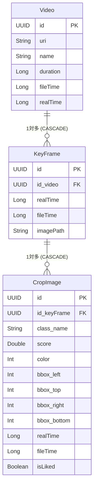

# 📱 KeyframePlayer 技術ツリー & システム構成書

## 1. アプリ概要 (Overview)
**KeyframePlayer** は、ウェアラブルカメラ等で常時録画された動画からキーフレーム抽出・物体検出（LiteRT / TensorFlow Lite）・色解析を行い、ローカルデータベースに記憶・インデックス化することで、落とし物や忘れ物を効率的に検索・特定・再生するローカル完結型スマートビデオプレイヤーアプリです。

---

## 2. 技術ツリー (Tech Stack Tree)

```text
KeyframePlayer
├── ⚙️ Language & Platform
│   ├── Kotlin (JVM 11)
│   ├── Android SDK (minSdk: 26, targetSdk: 35, compileSdk: 35)
│   └── AndroidX Core KTX / Lifecycle KTX
│
├── 🎨 UI Framework & Design System
│   ├── Jetpack Compose (Compose BOM 2024.02.01)
│   ├── Material Design 3 (Material3, Icons Extended)
│   ├── Coil (Compose 画像キャッシング & 非同期ロード)
│   └── Accompanist / Custom UI Components (ZoomableImage, SlimSlider, UnifiedGraphArea 等)
│
├── 🏗️ Architecture & Navigation
│   ├── Single Activity Architecture
│   ├── MVVM (Model-View-ViewModel) + Clean Architecture
│   ├── Navigation Compose (画面遷移・引数伝達)
│   └── Hilt (Dependency Injection / DI)
│
├── 💾 Data Persistence & Storage
│   ├── Room Database 2.6.1 (SQLite ORM, Foreign Key, Cascading, Multi-column Indexing)
│   ├── KSP (Kotlin Symbol Processing)
│   ├── Custom TypeConverters (UUID, Enum, Color 相互変換)
│   └── SAF (Storage Access Framework) / DocumentFile (外部SDカード・動画ファイルアクセス権限保持)
│
├── 🎬 Media & Video Processing
│   ├── Media3 / ExoPlayer (1.5.1) (動画再生・シーク・UI制御)
│   ├── MediaMetadataRetriever (動画からのフレーム/キーフレーム抽出)
│   └── Custom Video/KeyFrame Utilities (時間補正, 画像トリミング)
│
├── 🧠 Machine Learning & Image Processing
│   ├── LiteRT (旧 TensorFlow Lite API / Support / Metadata / GPU Delegate)
│   ├── Object Detection (SSD / YOLO モデルによる物体位置・スコア・クラス検知)
│   ├── AndroidX Palette API (検出領域からの主要カラー抽出)
│   └── Custom Detectors (ObjectDetector, ColorDetector)
│
└── ⚡ Async & Background Work
    ├── Kotlin Coroutines (Dispatchers.IO / StateFlow / SharedFlow)
    ├── Lifecycle / collectAsStateWithLifecycle (Compose 状態監視)
    └── WorkManager (2.11.2) + MLWorker (バックグラウンドでの推論・キーフレーム解析タスク処理)
```

---

## 3. システムアーキテクチャ & ディレクトリ構成

### アーキテクチャ パターン
- **Clean Architecture + Feature-by-Package**
  - `core`: 全体で共有されるデータベース、ドメインモデル、DIモジュール、共通ユーティリティ。
  - `detector`: 機械学習・色解析エンジン（LiteRT / Palette）。
  - `feature`: ドメイン固有機能（一覧・検索 `list` / 動画再生・解析詳細 `movie`）。
  - `worker`: バックグラウンド推論タスク (`WorkManager`)。

### ディレクトリ構成 (Package Structure)

```text
com.example.keyframeplayer/
├── MainActivity.kt                  # アプリのエントリーポイント & ナビゲーション定義
├── MainApplication.kt               # @HiltAndroidApp
├── RoomTypeConverters.kt            # Room用コンバーター
│
├── core/                            # 共通コアモジュール
│   ├── data/
│   │   ├── database/                # Room DB 関連
│   │   │   ├── dao/                 # CropImageDao, KeyFrameDao, VideoDao
│   │   │   ├── entity/              # CropImageEntity, KeyFrameEntity, VideoEntity
│   │   │   └── AppDatabase.kt
│   │   └── repository/              # ProcessingProgressRepository
│   ├── di/                          # Hilt DI モジュール (DatabaseModule, RepositoryModule)
│   ├── domain/model/                # CropImage, KeyFrame, ImageColor, DetectionResult
│   └── util/                        # DetectionSimulator 等
│
├── detector/                        # 解析エンジン
│   ├── ObjectDetector.kt            # LiteRT (TFLite) モデル推論処理
│   └── ColorDetector.kt             # Palette API による物体色判定
│
├── feature/                         # 機能別パッケージ
│   ├── list/                        # 【機能】検出結果・切り出し画像一覧画面
│   │   ├── domain/ & data/          # ListRepository, ListRepositoryImpl
│   │   └── presentation/            # ListViewModel, ListUpScreen
│   │
│   └── movie/                       # 【機能】動画再生 & タイムライン詳細画面
│       ├── domain/ & data/          # MovieRepository, VideoFrameExtractor
│       └── presentation/            # MovieViewModel, MovieScreen, MovieRoute
│           └── components/          # SlimSlider, ZoomableImage, UnifiedGraphArea 等
│
├── ui/                              # 共通UI & 設定・ローディング画面
│   ├── component/                   # ProcessingProgressBar
│   ├── screen/                      # DirectoryManagementScreen, VideoKeyFrameLoadingScreen 等
│   ├── theme/                       # Color, Theme, Type (Compose)
│   └── viewmodel/                   # VideoManagementViewModel, ImageRecognitionViewModel
│
├── util/                            # 共通ユーティリティ (VideoUtils, KeyFrameUtils)
└── worker/                          # MLWorker (WorkManager バックグラウンド処理)
```

---

## 4. データモデル & データベース構成 (Data Schema)

主要テーブルは **Foreign Key** と **Cascade Delete**、**インデックス設計**により最適化されています。



---

## 5. データ処理パイプライン (Data Processing Pipeline)

1. **動画フォルダ選択 & アクセス権限永続化 (SAF)**
   - `Storage Access Framework (SAF)` を介してフォルダを選択し、`takePersistableUriPermission` で永続権限を取得。
2. **キーフレーム抽出 (KeyFrame Extraction)**
   - `MediaMetadataRetriever` を利用し、動画から定期的なインターバルでフレーム画像を抽出・ローカルストレージへ保存。
3. **物体検出 & 色判定 (Object Detection & Color Analysis)**
   - `WorkManager` (MLWorker) 上で `ObjectDetector` (LiteRT/TFLite) を呼び出し、バウンディングボックスと認識スコアを取得。
   - `ColorDetector` (Palette API) でクロップ領域の代表色 (`ImageColor`) を判定。
4. **ローカルDBインデックス化 (Room Storage)**
   - 抽出結果（クロップ画像、実時間 `realTime`、物体種別、カラー、バウンディングボックス）を Room DB に集約保存。
5. **UI表示・検索 & 動画再生同期 (Search & Sync Playback)**
   - 色・物体名での高速検索、お気に入りフィルタリング。
   - 選択された物体クロップ画像から、元の動画の該当秒数（`realTime` / `fileTime`）を特定し ExoPlayer でピンポイント再生。

---

## 6. アプリの技術的特徴・こだわりポイント

- **事前のタグ付け不要**: 常時録画映像からAIが自動で「いつ・どこで・何が映ったか」を分類・インデックス化。
- **実時間 (RealTime) とファイル内時間 (FileTime) の同期**: アクションカメラ等の録画開始タイムスタンプから、動画内の相対時間を絶対時間（日時）へと変換・管理。
- **完全オンデバイス処理**: 外部サーバーを介さないため、プライバシー保護およびオフライン環境での高速処理を実現。
- **ハイパフォーマンスUI**: Compose State / Flow と Room インデックスの組み合わせにより、大量の検出結果リストをスムーズに描画・ズーム表示。
